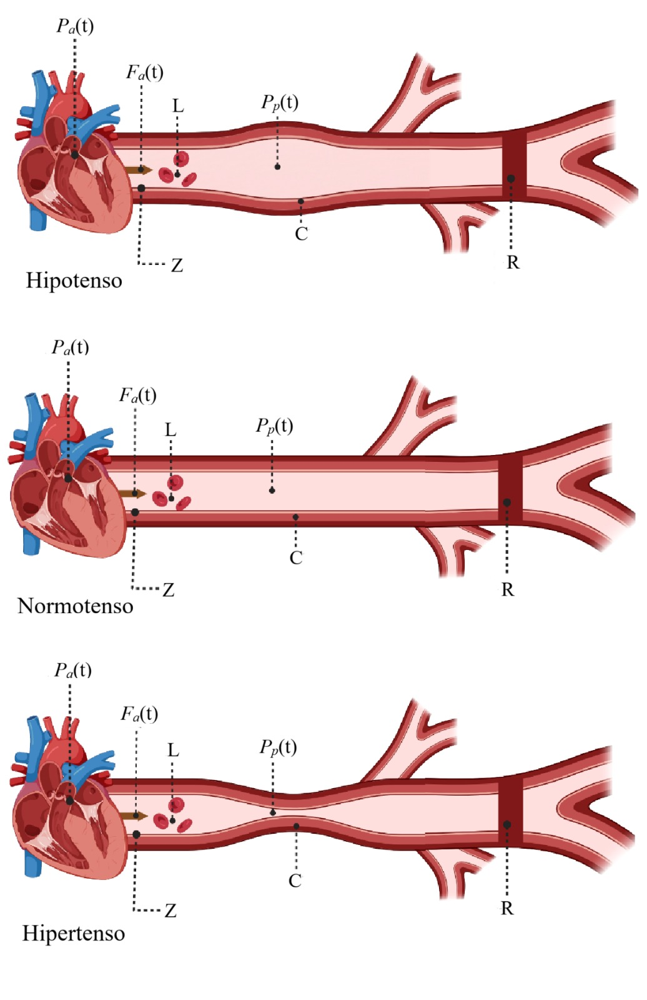

# Práctica 2: Modelo del sistema cardiovascular

## Información del estudiante

Sergio Andree Navarro Rodriguez; 23212219; l23212219@tijuana.tecnm.mx

Modelado de Sistemas Fisiológicos

Ingeniería Biomédica

## Docente

Dr. Paul Antonio Valle Trujillo; paul.valle@tectijuana.edu.mx

Departamento de Ingeniería Eléctrica y Electrónica, Tecnológico Nacional de México/IT Tijuana, Blvd. Alberto Limón Padilla s/n, Tijuana, C.P. 22454, B.C., México.

## Descripción de la asignatura

El modelado de sistemas fisiológicos es una herramienta importante en Ingeniería Biomédica, ya que permite representar el comportamiento de diferentes sistemas del cuerpo humano mediante modelos matemáticos y computacionales.

En esta asignatura se utilizan conceptos de circuitos eléctricos, sistemas de control y programación para estudiar la dinámica de sistemas fisiológicos. La construcción de analogías entre circuitos RLC y sistemas biológicos permite obtener funciones de transferencia, realizar simulaciones y diseñar controladores que ayuden a analizar la respuesta del sistema bajo diferentes condiciones.

## Objetivos

1. Representar el sistema cardiovascular mediante un modelo basado en un circuito RLC.
2. Obtener la función de transferencia del sistema.
3. Analizar el comportamiento de los casos hipotenso, normotenso e hipertenso.
4. Comparar las respuestas de los tres modelos en lazo abierto.
5. Implementar el modelo en MATLAB, Simulink y Python.
6. Diseñar controladores PID para los casos hipotenso e hipertenso.
7. Comparar la respuesta de los sistemas controlados con la respuesta del caso normotenso.

## Descripción del sistema

En esta práctica se utiliza una analogía eléctrica para representar de forma simplificada el comportamiento del sistema cardiovascular.

Los elementos del circuito representan diferentes propiedades del sistema:

- **R:** resistencia al flujo sanguíneo.
- **L:** inertancia asociada al movimiento de la sangre.
- **C:** capacitancia o *compliance* vascular.
- **Z:** impedancia característica del sistema.

La función de transferencia utilizada en el modelo es:

$$
H(s)=\frac{LRs+RZ}{CLRZs^2+(LR+LZ)s+ZR}
$$

A partir de esta función se estudian tres condiciones: hipotensión, normotensión e hipertensión. El caso normotenso se utiliza como referencia para comparar el comportamiento de los otros dos sistemas.

## Parámetros utilizados

| Condición | Z | R | L | C |
|---|---:|---:|---:|---:|
| Hipotenso | 0.01 | 1.000 | 0.001 | 3.500 |
| Normotenso | 0.01 | 1.000 | 0.001 | 1.500 |
| Hipertenso | 0.010 | 1.00 | 0.001 | 1.000 |

Con estos valores se obtienen las funciones de transferencia correspondientes y se compara la respuesta de cada condición cardiovascular.

## Controlador PID

Para los casos hipotenso e hipertenso se utiliza un controlador PID con el objetivo de aproximar su respuesta a la del sistema normotenso.

### Caso hipotenso

| Ganancia | Valor |
|:---:|---:|
| KP | 458.483 |
| KI | 1,118,300.387 |
| KD | 0.00627 |

### Caso hipertenso

| Ganancia | Valor |
|:---:|---:|
| KP | 126.595 |
| KI | 293,327.703 |
| KD | 0.00140 |

En Python, los controladores se implementan en lazo cerrado y posteriormente se comparan las respuestas controladas con el caso normotenso.

## Simulación

La señal utilizada para realizar las simulaciones se encuentra en el archivo `signal.xlsx`.

Las simulaciones se realizan durante un intervalo de 15 segundos y permiten obtener:

- Respuesta del individuo hipotenso.
- Respuesta del individuo normotenso.
- Respuesta del individuo hipertenso.
- Respuesta del sistema hipotenso con controlador PID.
- Respuesta del sistema hipertenso con controlador PID.

Los resultados se presentan mediante gráficas generadas en MATLAB y Python.

## Lista de archivos incluidos en el repositorio

1. Cuaderno computacional de MATLAB:
   - `Navarro23212219.mlx`
   - `Navarro23212219.pdf`

2. Modelo de Simulink:
   - `sistem.slx`

3. Código de Python:
   - `Navarro23212219.py`

4. Señal utilizada para las simulaciones:
   - `signal.xlsx`

5. Análisis matemático:
   - `Análisis matemático.pdf`

6. Imagen del modelo cardiovascular:
   - `Biorender.jpeg`

7. Resultados de MATLAB:
   - `Individual_matlab.pdf`
   - `Normotenso_matlab.pdf`
   - `Hipotenso_matlab.pdf`
   - `Hipertenso_matlab.pdf`

8. Resultados de Python:
   - `Individuos_python.pdf`
   - `hipotenso_python.pdf`
   - `Hipertenso_python.pdf`

9. Imágenes con los parámetros de los controladores:
   - `hipotensoparametros.jpeg`
   - `hipertensoparametros.jpeg`

## Palabras clave

Circuito RLC; Sistema cardiovascular; Modelado de sistemas fisiológicos; Función de transferencia; Controlador PID; Hipotensión; Normotensión; Hipertensión; MATLAB; Simulink; Python.

## Referencias

[1] P. A. Valle, *Syllabus para Modelado de Sistemas Fisiológicos*, Tecnológico Nacional de México / Instituto Tecnológico de Tijuana, Tijuana, B.C., México.
